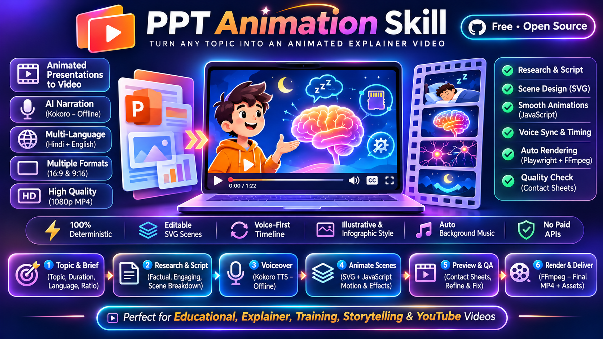
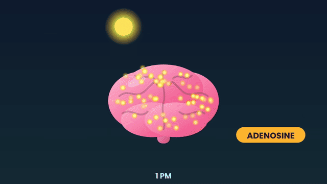
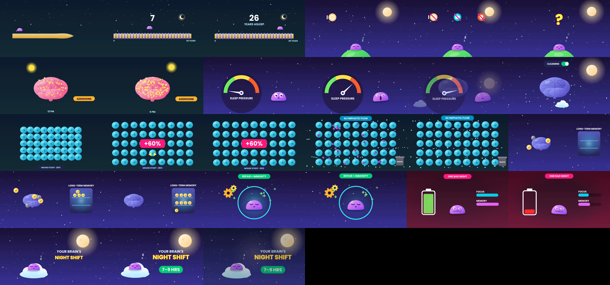

# PPT Animation Skill (हिंदी गाइड)

[](https://github.com/i-smiling-buddha/ppt-animation-skill/stargazers)
[](LICENSE)
[](https://agentskills.io)
[](https://skills.sh/i-smiling-buddha/ppt-animation-skill)



**कुछ भी समझाइए, pro की तरह animate कीजिए।**

> Flat-vector art, glowing light और smooth motion, सब आपका AI agent code से बनाता है। कोई paid API नहीं।

English: [README.md](README.md)

क्या आप Kurzgesagt या The Infographics Show जैसी explainer videos बनाना चाहते हैं, लेकिन After Effects नहीं आता? यह open-source Agent Skill आपके AI agent को सिखाती है कि वह script लिखे, narration record करे, हर scene को animated SVG के रूप में बनाए, और voiceover व background music के साथ एक तैयार **1080p MP4** render करे।

इसका look और motion PowerPoint vector animations से सीखा गया है: layered gradients, glossy highlights, motion paths, spins, fly-ins, particle trails और morph-style transitions। Skill इन्हें code (SVG + JavaScript) में दोबारा बनाती है, इसलिए हर frame deterministic, editable और render करने में free है।

YouTube explainers, Shorts/Reels, faceless channels, science और edtech content, product explainers, और बिना animation software के animated videos बनाने वाले हर व्यक्ति के लिए उपयोगी।



*Repo में शामिल example "Why We Sleep" (82 sec, Hindi narration, 11 scenes) पूरी तरह इसी skill से बना है।*

## Install

Open Agent Skills CLI से install कीजिए:

```bash
npx skills add i-smiling-buddha/ppt-animation-skill
```

पूछे जाने पर अपना target agent चुनिए। पूरे ecosystem के लिए [Skills directory](https://skills.sh) देखिए।

**Claude Code plugin:**

```
/plugin marketplace add i-smiling-buddha/ppt-animation-skill
/plugin install ppt-animation-skill@ppt-animation-skill
```

**Claude (claude.ai / desktop app):** `skills/infographic-explainer-video` folder को zip करके **Settings → Capabilities → Skills** में upload कीजिए।

**Manual:** `skills/infographic-explainer-video` folder को अपने agent के skills folder में copy कीजिए (`~/.claude/skills/`, या Codex, Copilot, Gemini CLI और Cursor के लिए `.agents/skills/`)।

## यह क्या करती है

| Step | क्या होता है |
|---|---|
| **Script** | Topic पर research, फिर hook → सवाल → 3–5 बातें → twist → takeaway वाली script; हर scene की एक line, और हर number का source |
| **Voiceover** | [Kokoro TTS](https://github.com/thewh1teagle/kokoro-onnx) से offline narration। Hindi voices `hm_omega`, `hm_psi`, `hf_alpha`, `hf_beta` और कई English voices, या आपकी अपनी recording |
| **Voice-first timing** | हर narration line एक scene बनती है और scene की length उसके audio से तय होती है, इसलिए आवाज़ और visuals हमेशा sync रहते हैं |
| **Scenes** | Starter template से animated SVG: blob character (पलकें झपकाता, साँस लेता, सोता है), brain, clouds, planets, चमकते तारे, glow, gauges, counters, particle streams |
| **Motion** | PowerPoint effects code में: fly-in, zoom/pop, spin, motion paths, draw-on, particle trails, scenes के बीच crossfade और धीमा camera push-in |
| **Preview** | हर scene का एक frame एक grid में, ताकि लंबे render से *पहले* layout की गलतियाँ ठीक हो जाएँ |
| **Render** | Playwright + ffmpeg से frame-by-frame, parallel chunks में, 30 fps H.264 MP4 (16:9 या 9:16) |
| **Sound** | Timeline पर voice, code से बना original ambient music (copyright-free) और scene बदलने पर हल्के whooshes, या आपका अपना licensed track |
| **QA** | तैयार video के frames की grid, ताकि clipping, safe area, readability और sync check हो सकें |

## Example tasks

अपने AI agent से कहिए:

- *"Why we sleep पर 60 second की explainer video बनाओ।"*
- *"Black hole पर 60 sec की Hindi explainer video बनाओ।"*
- *"इस script को animated video में बदलो। यह रही मेरी voice recording।"*
- *"Vaccines कैसे काम करती हैं, इस पर 45 sec का YouTube Short (9:16) बनाओ।"*
- *"अगर चाँद गायब हो जाए तो? Infographics Show style में बनाओ।"*
- *"सिर्फ़ scene 4 दोबारा render करो, label brain के ऊपर आ रहा है।"*

सारा काम आपकी scene file के पास एक `_work/` folder में होता है (build, chunks, timeline, mix), इसलिए लंबा काम scene-by-scene ठीक करके फिर से चलाया जा सकता है।



## बिना AI agent के pipeline चलाइए

ज़रूरतें: Python 3.10+, ffmpeg, और Chromium (Playwright से install होता है)।

```bash
git clone https://github.com/i-smiling-buddha/ppt-animation-skill
cd ppt-animation-skill
pip install playwright kokoro-onnx soundfile scipy pillow
playwright install chromium

# Voice model, लगभग 120 MB, एक बार download
mkdir tts && cd tts
curl -LO https://github.com/thewh1teagle/kokoro-onnx/releases/download/model-files-v1.0/kokoro-v1.0.int8.onnx
curl -LO https://github.com/thewh1teagle/kokoro-onnx/releases/download/model-files-v1.0/voices-v1.0.bin
cd ..

# शामिल example बनाइए
S=skills/infographic-explainer-video/scripts
python3 $S/voiceover.py examples/why-we-sleep/lines.txt vo --voice hm_omega --lang hi
bash   $S/make_video.sh examples/why-we-sleep/video.html vo why_we_sleep.mp4
```

अपनी video बनाने के लिए `skills/infographic-explainer-video/templates/master_template.html` copy कीजिए, हर narration line के लिए एक `scene(...)` लिखिए, और यही दो commands चलाइए।

## Compatibility

यह repository open [Agent Skills](https://agentskills.io) format follow करती है। यह Claude, Claude Code, OpenAI Codex, GitHub Copilot, Gemini CLI और Cursor जैसे compatible agents में काम करती है। Support और install location हर tool में अलग हो सकती है।

Agent को Python, ffmpeg और headless Chromium के साथ **code execution** चाहिए, और voice model download करने के लिए एक बार GitHub access चाहिए। बिना skill loader वाले chat app में `skills/infographic-explainer-video/SKILL.md` को chat की शुरुआत में paste कर दीजिए। वह script और scenes plan कर देगा, लेकिन render के लिए code चलाने वाला agent चाहिए।

## ज़रूरी सीमाएँ

- **आवाज़ synthetic है।** Kokoro natural लगती है, लेकिन इंसानी नहीं। Hindi में English शब्द Devanagari में लिखने पर सबसे अच्छा pronunciation आता है (स्लीप प्रेशर)। Channel के लिए आपकी अपनी recording सबसे अच्छी रहेगी।
- **Render में समय लगता है।** 1080p पर हर video second के लिए हर CPU core पर लगभग 3 second। 80 sec की video 2 cores पर करीब 7 मिनट लेती है।
- **Scenes आपका agent लिखता है।** Quality model पर और previews देखने पर निर्भर है। Skill preview और QA ज़रूर करवाती है, फिर भी publish से पहले video ख़ुद देखिए।
- **Lip-sync या character rigging नहीं है।** Characters पलकें झपकाते, साँस लेते, हिलते और react करते हैं, लेकिन screen पर बोलते नहीं।
- **9:16 के लिए दोबारा layout।** Vertical video crop नहीं, नए layout में बनती है, इसलिए उसका अलग pass लगता है।
- **Built-in music simple है।** यह code से बना ambient pad है। Richer sound के लिए अपना licensed track इस्तेमाल कीजिए।

**Originality note:** यह skill explainer animation की एक *genre* बनाती है। यह किसी channel के characters, logos, intros या music copy नहीं करती। अपने designs बनाइए, publish से पहले facts check कीजिए, और सिर्फ़ वही music इस्तेमाल कीजिए जो आपका है या जिसका license आपके पास है।

## Credits

- **Style study:** look और motion **JB Squiddy** की PowerPoint vector-animation files (rocket, pop-up book और cactus) को study करके सीखे गए। वे files इस repo में शामिल नहीं हैं; यहाँ का हर asset original है।
- Offline narration के लिए hexgrad की **[Kokoro TTS](https://huggingface.co/hexgrad/Kokoro-82M)** (Apache-2.0) और thewh1teagle का **[kokoro-onnx](https://github.com/thewh1teagle/kokoro-onnx)** (MIT)।
- Rendering के लिए **[Playwright](https://playwright.dev)** और **[FFmpeg](https://ffmpeg.org)**।

## Smiling Buddha की और free skills

- **[Smart Model Router Skill](https://github.com/i-smiling-buddha/smart-model-router-skill)**: tokens और API credits बचाइए। आपका agent हर coding task को उस सबसे सस्ते model को देता है जो उसे भरोसे से कर सके, result verify करता है, और fail होने पर ही बड़े model पर जाता है। `npx skills add i-smiling-buddha/smart-model-router-skill`
- **[AI Image Recognition Skill](https://github.com/i-smiling-buddha/ai-image-recognition-skill)**: preview से अंदाज़ा लगाना बंद कीजिए। आपका agent असली image file में real transparency (fake checkerboard पकड़ता है), सही format, size/DPI, colors, blur और GPS metadata check करता है। `npx skills add i-smiling-buddha/ai-image-recognition-skill`
- **[Reflection Skill](https://github.com/i-smiling-buddha/reflection-skill)**: किसी भी app, website, game या software को clean-room तरीके से दोबारा बनाइए: recon और build से लेकर parity score, rebrand और launch तक। `npx skills add i-smiling-buddha/reflection-skill`

## Contributing

Issues, bug reports, नए scene templates, palettes, example videos और pull requests का स्वागत है। कृपया copyrighted characters, music या दूसरों की animation files upload न करें। Guidelines के लिए [CONTRIBUTING.md](CONTRIBUTING.md) देखिए।

## License

MIT. Made by **Smiling Buddha** · [DESITechnology](https://desitechnology.com).
