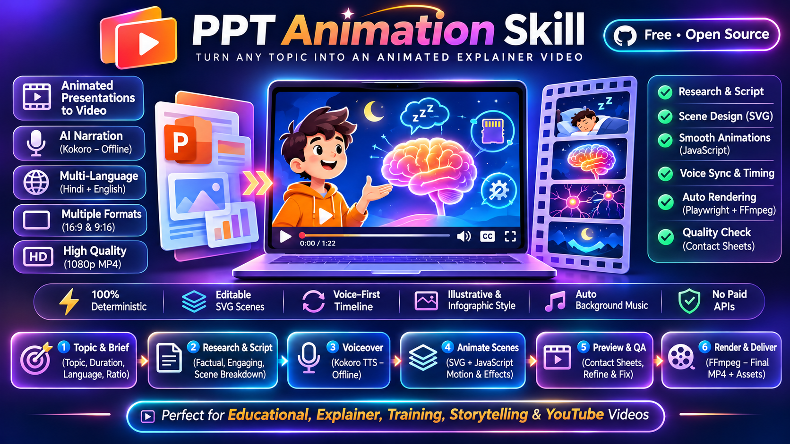
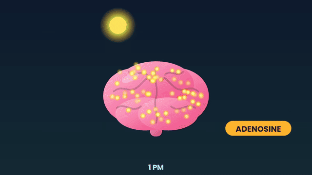

# PPT Animation Skill

[](https://github.com/i-smiling-buddha/ppt-animation-skill/stargazers)
[](LICENSE)
[](https://agentskills.io)
[](https://skills.sh/i-smiling-buddha/ppt-animation-skill)
[](#what-it-does)



**Explain anything. Animate it like a pro.**

> Flat-vector art, glowing light and smooth motion, made by your AI agent in code. No paid APIs.

हिंदी गाइड: [README.hi.md](README.hi.md)

Want explainer videos like the ones on Kurzgesagt or The Infographics Show, but don't know After Effects? This open-source Agent Skill teaches your AI agent to write the script, record the narration, draw every scene as animated SVG, and render a finished **1080p MP4** with voiceover and background music.

The look and motion were learned from PowerPoint vector animations: layered gradients, glossy highlights, motion paths, spins, fly-ins, particle trails and morph-style transitions. The skill rebuilds them in code (SVG + JavaScript), so every frame is deterministic, editable and free to render.

Useful for YouTube explainers, Shorts/Reels, faceless channels, science and edtech content, product explainers, and anyone who wants animated videos without animation software.



*From the included example, "Why We Sleep" (82 s, Hindi narration, 11 scenes), made start to finish with this skill.*

## Install

Install with the open Agent Skills CLI:

```bash
npx skills add i-smiling-buddha/ppt-animation-skill
```

Choose your target agent when prompted. See the [Skills directory](https://skills.sh) for the wider ecosystem.

**Claude Code plugin:**

```
/plugin marketplace add i-smiling-buddha/ppt-animation-skill
/plugin install ppt-animation-skill@ppt-animation-skill
```

**Claude (claude.ai / desktop app):** zip the `skills/infographic-explainer-video` folder and upload it under **Settings → Capabilities → Skills**.

**Manual:** copy the `skills/infographic-explainer-video` folder into your agent's skills folder (`~/.claude/skills/`, or `.agents/skills/` for Codex, Copilot, Gemini CLI and Cursor).

## What it does

| Step | What happens |
|---|---|
| **Script** | Researches the topic, writes a hook → question → 3–5 beats → twist → takeaway script, one line per scene, and notes the source of every number |
| **Voiceover** | Offline narration with [Kokoro TTS](https://github.com/thewh1teagle/kokoro-onnx). Hindi voices `hm_omega`, `hm_psi`, `hf_alpha`, `hf_beta` and many English voices, or your own recording |
| **Voice-first timing** | Every narration line becomes one scene, and each scene's length follows its audio, so voice and visuals stay in sync |
| **Scenes** | Animated SVG from a starter template: blob character (blinks, breathes, sleeps), brain, clouds, planets, twinkling stars, glow, gauges, counters, particle streams |
| **Motion** | PowerPoint effects as code: fly-in, zoom/pop, spin, motion paths, draw-on, particle trails, crossfades between scenes and a slow camera push-in |
| **Preview** | One frame per scene in a contact sheet, so layout problems are fixed *before* the long render |
| **Render** | Playwright + ffmpeg, frame by frame, in parallel chunks, to a 30 fps H.264 MP4 (16:9 or 9:16) |
| **Sound** | Voice placed on the timeline, an original synthesized ambient pad (copyright-free) and soft whooshes on scene changes, or your own licensed track |
| **QA** | A contact sheet of the finished video to check clipping, safe area, readability and sync |

### Style built in

| Palette | Colours |
|---|---|
| Space / Night | `#211840` `#423AA8` `#7F79D1` `#E565FF` `#33F5FF` `#1552FF` |
| Day / Nature | `#00A7E2` `#00D2EE` `#6EED65` `#01CB79` `#FFE4AF` `#FFFFFF` |
| Warm story | `#290D1C` `#B15141` `#FFE4AF` `#FFCE85` `#FF5F2D` `#FFFF47` |
| Neon pop | `#232453` `#5759B9` `#B6FF55` `#FF0066` `#A14BFF` `#00FFFF` |

## Example tasks

Ask your AI agent:

- *"Make a 60-second explainer video on why we sleep."*
- *"Black hole पर 60 sec की Hindi explainer video बनाओ।"*
- *"Turn this script into an animated video. Here's my voice recording."*
- *"Make a 45-second YouTube Short (9:16) on how vaccines work."*
- *"What if the Moon disappeared? Make it in Infographics Show style."*
- *"Re-render only scene 4, the label overlaps the brain."*

Work happens in a `_work/` folder next to your scene file (build, chunks, timeline, mix), so a long job can be fixed and resumed scene by scene.


## Run the pipeline without an AI agent

Requirements: Python 3.10+, ffmpeg, and Chromium (installed through Playwright).

```bash
git clone https://github.com/i-smiling-buddha/ppt-animation-skill
cd ppt-animation-skill
pip install playwright kokoro-onnx soundfile scipy pillow
playwright install chromium

# Voice model, about 120 MB, downloaded once
mkdir tts && cd tts
curl -LO https://github.com/thewh1teagle/kokoro-onnx/releases/download/model-files-v1.0/kokoro-v1.0.int8.onnx
curl -LO https://github.com/thewh1teagle/kokoro-onnx/releases/download/model-files-v1.0/voices-v1.0.bin
cd ..

# Build the included example
S=skills/infographic-explainer-video/scripts
python3 $S/voiceover.py examples/why-we-sleep/lines.txt vo --voice hm_omega --lang hi
bash   $S/make_video.sh examples/why-we-sleep/video.html vo why_we_sleep.mp4
```

| Script | Purpose |
|---|---|
| `voiceover.py` | One narration wav per line + `dur.json` |
| `build.py` | Injects durations into the scene file, exports `timeline.json`, reports JS errors |
| `peek.py` | One-frame-per-scene contact sheet before rendering |
| `render.py` | Deterministic frame-range renderer |
| `mix_audio.py` | Voice + synthesized pad + whooshes (or `--music your_track.mp3`) |
| `make_video.sh` | Whole pipeline: build → parallel render → concat → mix → MP4 + QA sheet |

To make your own video, copy `skills/infographic-explainer-video/templates/master_template.html`, write one `scene(...)` per narration line, and run the same two commands.

## Compatibility

This repository follows the open [Agent Skills](https://agentskills.io) format. It works in compatible agents such as Claude, Claude Code, OpenAI Codex, GitHub Copilot, Gemini CLI and Cursor. Exact support and installation locations vary by tool.

The agent needs **code execution** with Python, ffmpeg and a headless Chromium, plus one-time access to GitHub to download the voice model. For a chat app without a skill loader, paste `skills/infographic-explainer-video/SKILL.md` at the top of the chat. It will plan the script and scenes, but rendering needs an agent that can run code.

## Important limitations

- **The voice is synthetic.** Kokoro sounds natural but not human. Hindi works best with English words written in Devanagari (स्लीप प्रेशर). For a channel, your own recording sounds best.
- **Rendering takes time.** Roughly 3 seconds of wall time per second of video per CPU core at 1080p. An 80-second video takes about 7 minutes on 2 cores.
- **Scenes are written by your agent.** Quality depends on the model and on looking at the previews. The skill forces a preview and a QA pass, but review the video yourself before publishing.
- **No lip-sync or character rigging.** Characters blink, breathe, move and react; they don't speak on screen.
- **9:16 needs recomposing.** Vertical videos are re-laid out, not cropped, so they take a separate pass.
- **The built-in music is simple.** It's an ambient pad generated in code. Use your own licensed track for a richer sound.

**Originality note:** the skill recreates a *genre* of explainer animation. It never copies any channel's characters, logos, intros or music. Make your own designs, check facts before publishing, and only use music you own or have licensed.

## Credits

- **Style study:** the look and motion vocabulary were learned by studying PowerPoint vector-animation files by **JB Squiddy** (rocket, pop-up book and cactus animations). Those files are not included or redistributed here; every asset in this repo is original.
- **[Kokoro TTS](https://huggingface.co/hexgrad/Kokoro-82M)** by hexgrad (Apache-2.0) and **[kokoro-onnx](https://github.com/thewh1teagle/kokoro-onnx)** by thewh1teagle (MIT) for offline narration.
- **[Playwright](https://playwright.dev)** and **[FFmpeg](https://ffmpeg.org)** for rendering.

## More free skills by Smiling Buddha

- **[Smart Model Router Skill](https://github.com/i-smiling-buddha/smart-model-router-skill)**: save tokens and API credits. Your agent routes each coding task to the cheapest model that can reliably do it, verifies the result, and escalates only when it fails. `npx skills add i-smiling-buddha/smart-model-router-skill`
- **[AI Image Recognition Skill](https://github.com/i-smiling-buddha/ai-image-recognition-skill)**: stop guessing from previews. Your agent checks real transparency (catches fake checkerboards), true format, size/DPI, colors, blur and GPS metadata in the actual image file. `npx skills add i-smiling-buddha/ai-image-recognition-skill`
- **[Reflection Skill](https://github.com/i-smiling-buddha/reflection-skill)**: recreate any app, website, game or software clean-room, from recon and build to parity score, rebrand and launch. `npx skills add i-smiling-buddha/reflection-skill`

## Contributing

Issues, bug reports, new scene templates, palettes, example videos and pull requests are welcome. Please don't upload copyrighted characters, music or other people's animation files. See [CONTRIBUTING.md](CONTRIBUTING.md) for guidelines.

## License

MIT. Made by **Smiling Buddha** · [DESITechnology](https://desitechnology.com).
