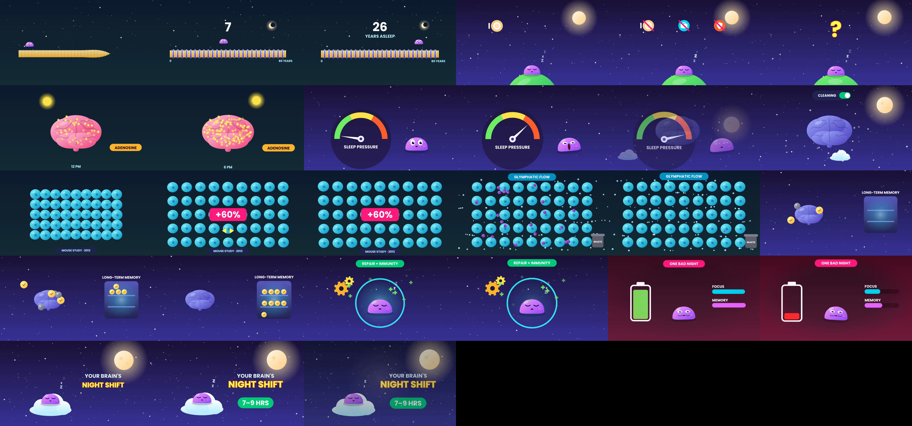

# 🎬 PPT Animation Skill: Infographic Explainer Video

A free, open-source **Claude skill** that turns a topic into a **Kurzgesagt / Infographics Show–style animated explainer video**: flat-vector art, glossy gradients, glowing light, smooth motion, voiceover and background music, rendered to a 1080p MP4.

The style and motion techniques were learned from **PowerPoint vector animations**: layered gradients, glossy highlights, motion paths, spins, fly-ins, particle trails and morph-style transitions. Here they are rebuilt in code (SVG + JavaScript), so every frame is deterministic, editable and free to render.


**Example:** *Why We Sleep* (82 s, Hindi narration, 11 scenes), built entirely with this skill:



---

## ✨ Features

- **No paid APIs.** Art is code, voice is offline [Kokoro TTS](https://github.com/thewh1teagle/kokoro-onnx), and the music is synthesized in code, so it is copyright-free.
- **Hindi + English narration.** Kokoro voices `hm_omega`, `hm_psi`, `hf_alpha`, `hf_beta` for Hindi and many voices for English. You can also use your own recording.
- **Voice-first timing.** Each narration line becomes one scene, and scene length follows the audio, so the voice always stays in sync.
- **Deterministic renderer.** Playwright + ffmpeg render frame by frame in parallel chunks.
- **Starter template.** Includes a cute blob character (blinks, breathes, sleeps), brain, clouds, twinkling stars, glow, pop-ins, motion paths, a crossfading scene engine and a slow camera push-in.
- **Built-in QA.** Contact-sheet previews before and after rendering.
- **16:9 and 9:16** (YouTube and Shorts/Reels).

## 📁 Repo layout

```
infographic-explainer-video/      ← the skill (copy this folder)
  SKILL.md
  templates/master_template.html
  scripts/  voiceover.py  build.py  peek.py  render.py  mix_audio.py  make_video.sh
examples/why-we-sleep/            ← full worked example (video.html + lines.txt)
docs/                             ← preview images
```

## 🚀 Install the skill

**Claude (claude.ai / desktop):** zip the `infographic-explainer-video` folder and upload it under **Settings → Capabilities → Skills**.

**Claude Code:** copy the folder into `~/.claude/skills/` (or your project's `.claude/skills/`).

Then just ask: *"Make an explainer video on why we sleep"* or *"Black hole पर 60 sec की video बनाओ"*.

## 🛠 Run the pipeline manually

```bash
pip install playwright kokoro-onnx soundfile scipy pillow
playwright install chromium
mkdir tts && cd tts
curl -LO https://github.com/thewh1teagle/kokoro-onnx/releases/download/model-files-v1.0/kokoro-v1.0.int8.onnx
curl -LO https://github.com/thewh1teagle/kokoro-onnx/releases/download/model-files-v1.0/voices-v1.0.bin
cd ..

S=infographic-explainer-video/scripts
python3 $S/voiceover.py examples/why-we-sleep/lines.txt vo --voice hm_omega --lang hi
bash   $S/make_video.sh examples/why-we-sleep/video.html vo why_we_sleep.mp4
```

Requirements: Python 3.10+, ffmpeg, Chromium (via Playwright).

## ⚖️ Originality note

This skill recreates a **genre** of explainer animation. It does not copy any channel's characters, logos, intros or music. Please make your own designs, and only use music you own or have licensed.

## 📜 License

[MIT](LICENSE): free for personal and commercial use.

---

<p align="center">Made by <b>Smiling Buddha</b> · <a href="https://desitechnology.com">DESITechnology</a></p>
